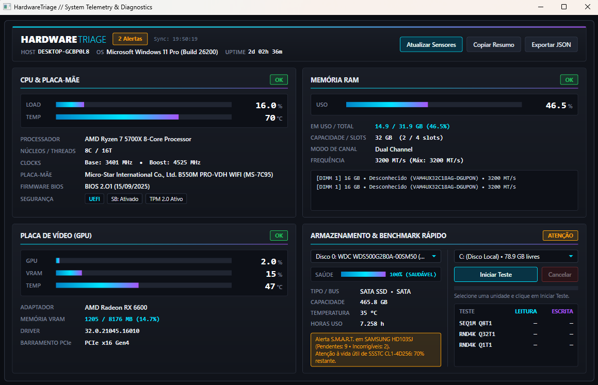

# HardwareTriage

A portable Windows desktop hardware diagnostics and quick-benchmark tool built with **C# (.NET 8 + WPF)**, combining core telemetry from CPU-Z, GPU-Z, CrystalDiskInfo, and CrystalDiskMark into a single 2x2 Dark Mode dashboard inspired by MSI Afterburner.



## Key Features

- **CPU & Motherboard**: Processor model, physical cores / logical threads, base & live boost clocks, package temperature & load, motherboard manufacturer/model, BIOS version/date, Boot mode (`UEFI` / `Legacy`), `Secure Boot`, and `TPM 2.0` status.
- **Memory (RAM)**: Live memory usage (`GB` & `%`), installed capacity, used/total slots, `Single Channel` vs `Dual Channel` detection, configured vs rated module frequency (`MT/s`), and per-DIMM breakdown.
- **GPU**: Primary discrete and secondary integrated GPU detection, total/used VRAM (`>4 GB` accurate via Registry), driver version, core temperature & load, and live PCIe link width/generation (`cfgmgr32.dll` / `setupapi.dll`).
- **Storage & S.M.A.R.T.**: Disk selector across `NVMe`, `SATA SSD`, and `HDD` drives with temperature, remaining health (`100 - PercentageUsed` for NVMe and direct ATA S.M.A.R.T. attributes/thresholds), power-on hours, TBW, and critical sector counters (`0x05`, `0xC5`, `0xC6`).
- **Uncached Disk Benchmark**: Win32 `CreateFileW` (`FILE_FLAG_NO_BUFFERING | FILE_FLAG_WRITE_THROUGH | FILE_FLAG_OVERLAPPED`) with 4096-byte aligned native buffers (`SEQ1M Q8T1`, `RND4K Q32T1`, `RND4K Q1T1`) and automatic temp-file cleanup.
- **Traffic-Light Diagnostic Rules Engine**: Automated `OK` (`#22C55E`), `Warning` (`#F59E0B`), and `Critical` (`#EF4444`) evaluations, plus one-click clipboard summary and JSON export.

## Build & Publish (Portable Single-File)

```powershell
dotnet build -c Release
dotnet publish -c Release -r win-x64
```

> **Note**: Requires Administrator privileges (`app.manifest`) to read hardware temperature sensors and low-level S.M.A.R.T. attributes.

## Known Limitations

- **RAM Channel Mode Heuristic**: Windows SMBIOS/WMI (`Win32_PhysicalMemory`) does not directly report the active memory controller channel mode. `Dual Channel` vs. `Single Channel` is inferred from DIMM count, capacity symmetry, and slot/channel labels (`ChannelA`/`ChannelB`, `DIMM_A`/`DIMM_B`). If a motherboard BIOS uses generic slot names (`DIMM 0`, `DIMM 1`, etc.) without channel tags and two identical modules are installed on the same channel, it may report `Dual Channel`.
- **On-Demand Sensor Polling**: Telemetry is collected at startup and when clicking **Atualizar Sensores** rather than via continuous background polling, keeping CPU overhead at zero during disk benchmarks.
- **RAID & USB Enclosure Pass-Through**: Generic USB enclosures without UASP/SAT pass-through or certain hardware/VMD RAID controllers may hide individual drive S.M.A.R.T. attributes from Windows.

---

## AI Generation Prompt (Orchestrator Blueprint)

Use the structured prompt below to regenerate or scaffold the complete **HardwareTriage** architecture cleanly across 4 validated phases without rework:

```markdown
Act in Orchestrator mode (splitting work into parallel stages, validating each phase with `dotnet build` and fixing all errors and warnings before moving to the next phase).

Your mission is to build **HardwareTriage**, a portable Windows x64 desktop application in C# (.NET 8 + WPF) that unifies core diagnostics from CPU-Z, GPU-Z, CrystalDiskInfo, and CrystalDiskMark into a single 2x2 dashboard featuring a modern **MSI Afterburner-inspired** dark aesthetic (Dark Gunmetal/Carbon `#0B0D12`/`#191D26`, `#2A303D` borders, Cyan `#00E5FF` → Violet `#A855F7` gradient accents, `Consolas` telemetry readouts, and LED-style segmented meters).

---

### PHASE 1: Project Setup, UAC Manifest & Core Models
1. Create the WPF project (`net8.0-windows`, `<UseWPF>true</UseWPF>`, `<Nullable>enable</Nullable>`, `<AllowUnsafeBlocks>true</AllowUnsafeBlocks>`).
2. Configure portable single-file publishing in `.csproj`:
   - `<RuntimeIdentifier>win-x64</RuntimeIdentifier>`
   - `<PublishSingleFile>true</PublishSingleFile>`
   - `<SelfContained>true</SelfContained>`
   - `<IncludeNativeLibrariesForSelfExtract>true</IncludeNativeLibrariesForSelfExtract>`
3. Install compatible NuGet packages (avoiding `NU1605` downgrades):
   - `LibreHardwareMonitorLib` (`0.9.4`)
   - `System.Management` (`9.0.0` — aligned with `LibreHardwareMonitorLib`'s transitive dependency)
   - `CommunityToolkit.Mvvm` (`8.3.2`)
   - Use built-in `System.Text.Json` for JSON export (do not install `Newtonsoft.Json`).
4. Create and link `app.manifest` with:
   - `<requestedExecutionLevel level="requireAdministrator" uiAccess="false" />`
   - `<supportedOS Id="{8e0f7a12-bfb3-4fe8-b9a5-48fd50a15a9a}" />` (critical for accurate Windows 11 build detection >= 22000).
5. Create `Models/HardwareModels.cs` with `[assembly: SupportedOSPlatform("windows")]` (preventing `CA1416` warnings), defining `HardwareSnapshot`, `SystemHeaderInfo`, `CpuMotherboardInfo`, `MemorySummaryInfo` (including live usage in GB and %), `MemoryModuleInfo`, `GpuSummaryInfo`, `StorageDiskInfo` (including critical sector counters `ReallocatedSectors`, `PendingSectors`, `UncorrectableSectors`, `ThresholdExceeded`, and `override string ToString() => DisplayTitle`), `DriveTargetInfo` (with `override string ToString() => DisplayText`), `BenchmarkRowResult` (`ObservableObject`), and `SubsystemEvaluation`.

*Validate with `dotnet build` (0 errors and 0 warnings).*

---

### PHASE 2: Hardware & S.M.A.R.T. Collection Services (`Services/`)
1. **`HardwareMonitorManager`**: Encapsulate a single thread-safe (`lock`) instance of `LibreHardwareMonitor.Hardware.Computer` (`Cpu`, `Gpu`, `Storage`, `Motherboard`, `Memory`) with an `UpdateVisitor` and `IDisposable`.
2. **`CpuMotherboardService`**:
   - Hostname, Windows edition/build (`IsWindows11` for `Build >= 22000`), and uptime (`Environment.TickCount64`).
   - CPU (`Win32_Processor` + LibreHardwareMonitor sensors: prioritize `Core (Tctl/Tdie)`, `CPU Package`, and `Package` for temperature; active clocks > 300 MHz for boost; `CPU Total` for load).
   - Motherboard (`Win32_BaseBoard`), BIOS (`Win32_BIOS`), boot mode (`UEFI`/`Legacy` via Win32 `GetFirmwareType` + Registry), `Secure Boot` (Registry), and `TPM 2.0` (`root\CIMV2\Security\MicrosoftTpm:Win32_Tpm`).
3. **`MemoryService`**:
   - Use `Win32_PhysicalMemoryArray` (total slots) and `Win32_PhysicalMemory` (installed DIMMs, capacity, `ConfiguredClockSpeed` vs `Speed`, mapping JEDEC hex manufacturer IDs).
   - Detect `Single Channel` vs `Dual Channel` based on stick count, capacity symmetry, and slot channel tags.
   - Use Win32 P/Invoke `GlobalMemoryStatusEx` (`kernel32.dll`) to read **live RAM usage** (`UsedCapacityGb`, `UsableCapacityGb`, `UsagePercent`).
4. **`GpuService`**:
   - Identify primary discrete and secondary integrated GPUs via `Win32_VideoController` + Registry (`HardwareInformation.qwMemorySize` to bypass the 4 GB `AdapterRAM` cap) + LibreHardwareMonitor sensors (Temperature, Core Load %, VRAM Used/Total, PCIe Throughput).
   - For **PCIe link width/generation**, do NOT rely solely on `Win32_PnPEntity.GetDeviceProperties`: implement native P/Invoke via `cfgmgr32.dll` (`CM_Locate_DevNodeW`, `CM_Get_DevNode_PropertyW`, `CM_Get_Parent`) and `setupapi.dll` (`SetupDiGetClassDevsW` for the `Display` class) reading `DEVPKEY_PciDevice_CurrentLinkSpeed/Width` and `MaxLinkSpeed/Width`.
5. **`StorageAndSmartService`** (aligned with CrystalDiskInfo):
   - Combine `Win32_DiskDrive`, `MSFT_PhysicalDisk` / `MSFT_StorageReliabilityCounter`, WMI `MSStorageDriver_FailurePredictStatus` / `FailurePredictData` / `FailurePredictThresholds`, and `LibreHardwareMonitor` (`NVMeGeneric` + `AtaStorage.Smart.ReadSmartData()` / `ReadSmartThresholds()`).
   - **Anti-false-100% rules**:
     - For NVMe, compute health strictly from `100 - NVMeHealthInfo.PercentageUsed` or the `Remaining Life` sensor (NEVER use `Available Spare` as the health percentage).
     - Never treat `MSFT_StorageReliabilityCounter.Wear == 0` as `100%` unless confirmed by an SSD wear sensor; always prioritize direct controller/S.M.A.R.T. attributes.
     - For SATA SSDs, parse `0xE7`, `0xE9`, `0xCA` (handling `100 - Raw` where applicable), `0xB1`, `0xE6`, `0xF5`, `0xA9` (and `0xE8` only as a last fallback), and identify SATA SSDs even when `"SSD"` is absent from the model string.
     - For both HDDs and SSDs, extract `0x05` (Reallocated), `0xC5` (Pending), `0xC6` (Uncorrectable), `0x09` (Power-On Hours), `0xF1`/sensors (TBW), and check `CurrentValue <= Threshold` for imminent failure.

*Validate with `dotnet build` (0 errors and 0 warnings).*

---

### PHASE 3: Win32 Uncached Disk Benchmark (`Services/DiskBenchmarkService.cs`)
1. Enumerate ready drives (`DriveInfo.GetDrives()`).
2. Use P/Invoke `CreateFileW` with `FILE_FLAG_NO_BUFFERING | FILE_FLAG_WRITE_THROUGH | FILE_FLAG_OVERLAPPED` and `CancelIoEx`, creating a temporary 512 MiB file in the selected drive root (after checking available free space).
3. Implement `AlignedMemoryManager : MemoryManager<byte>` backed by `NativeMemory.AlignedAlloc(..., 4096)` and `AlignedFree` (mandatory for `FILE_FLAG_NO_BUFFERING`) and fill write buffers with a non-zero pseudo-random pattern (preventing SSD compression shortcuts).
4. Run asynchronously (`RandomAccess.ReadAsync`/`WriteAsync`) with `IProgress` and `CancellationToken`:
   - `SEQ1M Q8T1` (1 MiB blocks, queue depth 8, Read & Write)
   - `RND4K Q32T1` (4 KiB aligned offsets, queue depth 32, Read & Write)
   - `RND4K Q1T1` (4 KiB aligned offsets, queue depth 1, Read & Write)
5. Ensure pending I/Os are canceled safely, native buffers are disposed, and the temp file is deleted inside `finally`.

*Validate with `dotnet build` (0 errors and 0 warnings).*

---

### PHASE 4: Diagnostic Rules Engine & MSI-Style WPF UI
1. Create `Services/DiagnosticRulesEngine.cs` with `Ok` (`#22C55E`), `Warning` (`#F59E0B`), and `Critical` (`#EF4444`) evaluations, joining multiple alerts per subsystem with `Environment.NewLine`:
   - **RAM**: Warning if `ConfiguredClockSpeed < MaxModuleSpeed` (XMP/EXPO disabled) or `2+` DIMMs in `Single Channel`.
   - **Temperatures**: Warning `> 75°C` (CPU/GPU) or `> 60°C` (SSD); Critical `> 85°C` (CPU/GPU) or `> 70°C` (SSD).
   - **Storage**: Warning if health is `50%–75%` or reallocated/pending/uncorrectable sectors `> 0`; Critical if health `< 50%`, `PredictFailure`, or `ThresholdExceeded`.
   - **System**: Warning if Windows 11 is missing active `Secure Boot` or `TPM 2.0`.
   - Include `FormatClipboardReport` to generate a clean copy-ready diagnostic report.
2. Create `ViewModels/MainViewModel.cs` (`ObservableObject`, `IDisposable`), triggering async collection via `Task.Run` at startup with a discrete loading indicator and commands for `Refresh Sensors`, `Copy Summary`, `Export JSON`, `Start Benchmark`, and `Cancel`.
3. Create `MainWindow.xaml` (1180x760 resizable) and `MainWindow.xaml.cs` (with value converters and `Dispose()` on `OnClosed`):
   - **Top Bar**: `HARDWARETRIAGE` title, overall status badge, discrete loading indicator, Host/OS/Uptime, and the 3 action buttons.
   - **Uniform 2x2 Grid** featuring MSI-style LED segmented bars (`OpacityMask` + `DrawingBrush` slicing a `#0284C7 → #00E5FF → #A855F7` gradient):
     - **Card 1**: CPU & Motherboard (Load/Temp meters, clocks, cores/threads, motherboard, BIOS, Boot/SB/TPM chips + status badge and alert banner).
     - **Card 2**: Memory RAM (Usage % meter + `Used / Total GB`, slots, channel mode, frequency, DIMM list + XMP/Channel alert).
     - **Card 3**: GPU (Load/VRAM %/Temp meters, VRAM used/total, driver, **PCIe link width/gen**, secondary iGPU if present + alerts).
     - **Card 4** split horizontally: left pane with Dark Mode `ComboBox` (`ItemTemplate` + `SelectionBoxItemTemplate` + `TextTrimming`), Health % meter, S.M.A.R.T. metrics (Type/Bus, Capacity, Temp, Power-On Hours, TBW, Sectors) and alerts; right pane with **Quick Benchmark** (drive selector, Start/Cancel, progress meter, and `SEQ1M Q8T1`, `RND4K Q32T1`, `RND4K Q1T1` table).

Validate the entire solution with `dotnet build` (0 errors and 0 warnings) and publish the portable single-file executable via `dotnet publish -c Release -r win-x64`.
```
